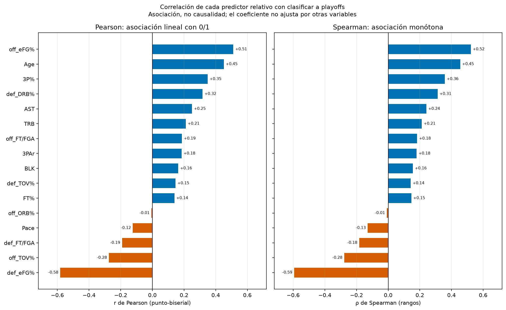
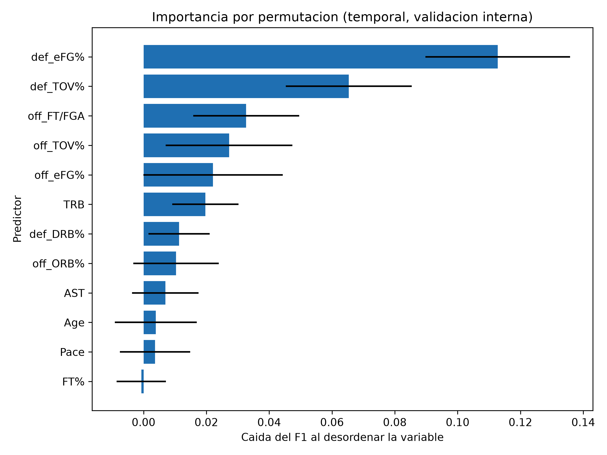
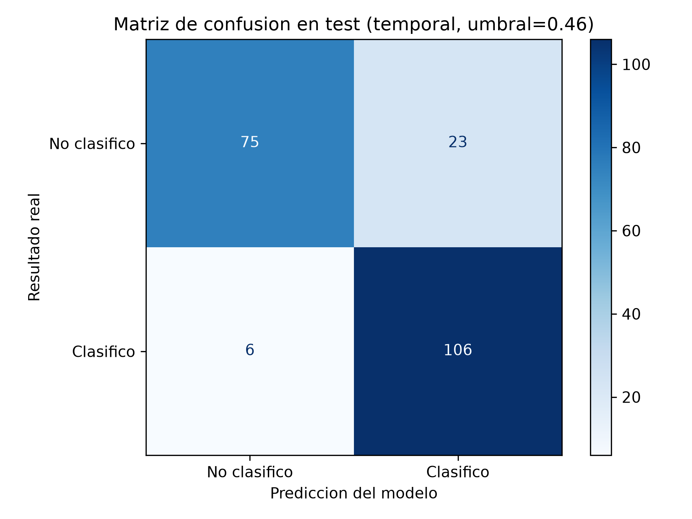

# Informe final

> **BORRADOR PARA REVISIÓN — PENDIENTE LA URL DEL VIDEO.**
> Los resultados numéricos provienen de ejecuciones reales registradas en
> `outputs_corrida2_16vars/` y `outputs_corrida2_16vars_fase4/`. Los datos institucionales
> fueron aportados por el equipo; solo queda pendiente la URL de YouTube.

---

## Portada

| Campo | Valor |
|---|---|
| Institución | Universidad Americana de Barranquilla |
| Facultad / programa | Facultad de Ingeniería de Sistemas |
| Asignatura | Ciencia de Datos con Python |
| Docente | Edgar Morillo Vergel |
| Periodo | 7.º semestre · Barranquilla, Colombia |
| Título | ¿Qué estadísticas de juego explican que un equipo de la NBA llegue a playoffs? |
| Integrantes | Mauricio Villafañe · Santiago de la Hoz |
| Fecha de entrega | 19 de noviembre de 2026 |
| Repositorio | https://github.com/ctlucifer1504-bit/proyecto_ciencia_de_datos |
| Video | Pendiente de publicación (Etapa E) |

**Datos: Sports Reference LLC / Basketball-Reference.com.**

---

## Enlaces de acceso

| Recurso | Enlace |
|---|---|
| Repositorio GitHub | https://github.com/ctlucifer1504-bit/proyecto_ciencia_de_datos |
| Video en YouTube | `[ENLACE DE YOUTUBE: pendiente]` |

El repositorio es público y no incluye los datos: `data/README.md` explica cómo
regenerarlos. El enlace del video se incorpora en la versión final del PDF, después de la
grabación.

---

## Resumen

Se analizaron 805 equipo-temporada de la NBA entre 2000 y 2026 para identificar qué
estadísticas de juego se asocian con la clasificación a playoffs. Se construyeron 16
predictores relativos al promedio de la liga de cada temporada: ocho de los cuatro factores
(eficiencia de tiro, pérdidas, rebotes y tiros libres, en ataque y defensa) y ocho variables
de contexto y estilo. Se compararon una regresión logística y un Random Forest, con
`GridSearchCV` de 5 folds y dos protocolos de evaluación: temporal (entrenar 2000–2019,
probar 2020–2026) y estratificado 80/20.

La regresión logística alcanzó un F1 de 0,879, una accuracy de 0,862 y un ROC-AUC de 0,946
en el test temporal con el umbral titular 0,50, muy por encima de la línea base trivial
(F1 0,696 y ROC-AUC 0,500 en ese mismo test; 0,699 con el prior global). El modelo optimizado obtuvo F1 0,866, accuracy 0,848 y ROC-AUC
0,942 con el mismo umbral; con el umbral 0,46 elegido en validación interna llegó a F1 0,880
y accuracy 0,862, sin superar de forma sustantiva al base. El Random Forest fue inferior.
La optimización de hiperparámetros mejoró apenas la validación cruzada (+0,004 en F1) y **no
se tradujo en una mejora del test**, un resultado que se reporta sin inflarlo. Las variables
más importantes por permutación fueron la eficiencia de tiro permitida (`def_eFG%`) y las
pérdidas forzadas (`def_TOV%`), calculadas en una validación interna de 119 filas. Se detectó
multicolinealidad alta en `TRB`, `Pace` y `off_ORB%`, por lo que los coeficientes no se
interpretan como efectos causales.

**Palabras clave:** NBA, playoffs, clasificación binaria, scikit-learn, validación temporal,
fuga de datos.

---

## 1. Introducción

### 1.1 Contexto

La NBA es una liga deportiva con 30 franquicias y una temporada regular de 82 partidos (con
excepciones documentadas). Al final de la temporada, 16 equipos clasifican a playoffs. La
pregunta de si el estilo de juego —y no solo el récord— anticipa esa clasificación es
relevante para aficionados, analistas y equipos.

### 1.2 Problema

Dado el perfil estadístico de un equipo al final de la temporada regular, ¿es posible predecir
si clasificará a playoffs y qué dimensiones del juego pesan más?

### 1.3 Objetivos

**General:** construir un modelo de clasificación binaria que estime la probabilidad de que un
equipo clasifique a playoffs a partir de 16 estadísticas de juego relativas a su temporada.

**Específicos:**

1. Extraer datos de 27 temporadas desde Basketball-Reference.
2. Limpiar y consolidar las tablas en un único dataset equipo-temporada.
3. Explorar distribuciones, correlaciones y diferencias entre clasificados y no clasificados.
4. Comparar un modelo base con un modelo optimizado mediante `GridSearchCV`.
5. Evaluar con un protocolo temporal y reportar métricas más allá de la accuracy.
6. Documentar limitaciones, riesgos de fuga y reproducibilidad.

### 1.4 Justificación

El proyecto cubre el ciclo completo de ciencia de datos: extracción web, limpieza, exploración,
modelado, evaluación y comunicación. Usa una fuente real, un problema binario interpretable y
un conjunto de datos de tamaño manejable (805 filas) que permite auditoría completa.

### 1.5 Alcance y exclusiones

- **Incluye:** 27 temporadas (2000–2026), un registro por equipo-temporada.
- **Excluye:** playoffs como tales (solo se predice la clasificación), datos de jugadores,
  lesiones, salarios, entrenadores y calendario detallado.
- **No es causal:** el diseño es observacional.

---

## 2. Marco de datos

### 2.1 Fuente

Basketball-Reference, una página por temporada:
`https://www.basketball-reference.com/leagues/NBA_{año}.html`, donde el año es el de cierre
de la temporada (2026 = 2025-26).

- **Tablas usadas:** *Advanced* y *Per Game*.
- **Extracción:** `requests` + `pandas.read_html`, con pausa de 4 s y caché local.
- **Límite del sitio:** ~20 peticiones/minuto. El proyecto no evade bloqueos.
- **Términos de uso:** cláusula 5(k) revisada el 2026-11-18; los datos no se
  redistribuyen. Ver `docs/CONSIDERACIONES_LEGALES.md`.

### 2.2 Unidad de análisis y variable objetivo

- **Unidad:** equipo-temporada.
- **Filas:** 805.
- **Variable objetivo:** `playoffs` ∈ {0, 1}; 432 clasificados (53,7 %) y 373 no (46,3 %).
- **Clave única:** `(season, Team)`; 0 duplicados.

### 2.3 Los 16 predictores

| Grupo | Variables |
|---|---|
| Cuatro factores ofensivos | `off_eFG%`, `off_TOV%`, `off_ORB%`, `off_FT/FGA` |
| Cuatro factores defensivos | `def_eFG%`, `def_TOV%`, `def_DRB%`, `def_FT/FGA` |
| Contexto y estilo | `Age`, `Pace`, `3PAr`, `3P%`, `FT%`, `AST`, `BLK`, `TRB` |

Cada predictor se usa en su versión relativa:

```text
x_rel = x − promedio de la liga en esa temporada
```

**Por qué:** comparar valores absolutos entre 2000 y 2026 mediría la época, no la calidad
relativa. Por ejemplo, `3PAr` pasó de 0,167 a 0,415 en promedio de liga.

**Costo:** la transformación es transductiva (usa el promedio de todos los equipos, incluidos
los del test). No usa el objetivo. Se justifica porque el momento de predicción es el final de
la temporada regular, y se contrasta con un modelo de variables absolutas.

### 2.4 Variables excluidas

- **Fuga de información:** `W`, `L`, `PW`, `PL`, `MOV`, `SOS`, `SRS`, `NRtg`, `win_pct`,
  `ORtg`, `DRtg`.
- **Causalidad inversa:** `Attend.`, `Attend./G` (además tienen 4 nulos cada una).
- **Fueron de la corrida histórica de 19 variables, no de la actual:** `FTr`, `PF`, `STL`.
- **Totales y conteos:** `G`, `MP`, `FG`, `FGA`, etc.

El diccionario completo está en `docs/DICCIONARIO_DATOS.md`.

### 2.5 Calidad de datos

| Comprobación | Resultado |
|---|---|
| Nulos en los 16 predictores | 0 |
| Infinitos | 0 |
| Duplicados `(season, Team)` | 0 |
| Nulos en contexto | `Attend.` = 4, `Attend./G` = 4 |
| Balance del objetivo | 432 / 373 |
| Temporadas acortadas | 2012 (66), 2020 (64–75), 2021 (72); 2013 con dos equipos de 81 |

No se elimina ninguna observación. Los posibles nulos futuros se imputarían con la mediana
aprendida solo del train, dentro del `Pipeline`.

### 2.6 Ética y privacidad

- Los datos son públicos y agregados por equipo; no hay datos personales sensibles.
- No se usan nombres de jugadores ni información médica.
- Se respetan los límites de acceso del sitio.
- Se declara el uso de asistentes de IA en `docs/DECLARACION_IA.md`.

---

## 3. Metodología

### 3.1 Fase I — Extracción

`scraping.py` recorre 27 temporadas con un `for`, descarga cada página, extrae las tablas
*Advanced* y *Per Game*, valida el número de equipos y guarda fragmentos en
`data/raw/fragments/`. Los HTML se cachean en `data/raw/html/`. El log está en
`outputs/logs/scrape_log.csv`.

**Resultado:** 27/27 temporadas, 29 equipos en 2000–2004 y 30 desde 2005, 805 filas.

### 3.2 Fase II — Limpieza

`limpieza.py`:

1. `pd.concat()` de los 54 fragmentos.
2. Eliminación y verificación de duplicados.
3. Conversión numérica explícita y auditada.
4. Unión de *Advanced* y *Per Game* por `(season, Team)`.
5. Filtros compuestos con `&` y `|` agrupados con paréntesis.
6. Verificación de consistencia del objetivo entre tablas.

**Resultado:** `data/processed/nba_teams_clean.csv`, 805 × 52, SHA256
`c04704d9…ea3ea9`.

### 3.3 Fase III — Exploración

`exploracion.py` genera 11 figuras y 14 tablas: balance de clases, distribuciones, boxplots,
correlaciones, mapa de calor, dispersión, quintiles, atípicos, deriva de época y calidad.

**Hallazgos principales:**

- Correlaciones con el objetivo: `def_eFG%` −0,582; `off_eFG%` +0,511; `Age` +0,452;
  `3P%` +0,349; `def_DRB%` +0,317; `off_TOV%` −0,275.
- Única redundancia |r| ≥ 0,70: `off_eFG%`–`3P%` (0,709).
- Diferencias entre clases (d de Cohen): `def_eFG%` −1,435; `off_eFG%` +1,191;
  `Age` +1,014.
- Atípicos: máximo 15 casos en una variable (`3P%`, 1,86 %); el mínimo es 1; no se eliminan.
- Deriva de época: `3PAr` 0,167 → 0,415; `Pace` 93,1 → 99,4.

### 3.4 Fase IV — Modelado

#### 3.4.1 Pipeline

```text
SimpleImputer(mediana) → StandardScaler → clasificador
```

La imputación y el escalado se ajustan **dentro de cada fold**, nunca con el test.

#### 3.4.2 Modelos y grillas

| Modelo | Grilla | Combinaciones |
|---|---|---:|
| Regresión logística | `C ∈ {0.001 … 10000}` | 8 |
| Random Forest | 2 × 4 × 3 × 2 | 48 |

- `GridSearchCV` con 5 folds, `refit="f1"`.
- Modelo base = hiperparámetros por defecto, evaluado con los **mismos folds**.

#### 3.4.3 Protocolos de evaluación

**Principal — temporal:**

- Train: 2000–2019 (595 filas).
- Test: 2020–2026 (210 filas).
- CV: `StratifiedGroupKFold(5)`, agrupando por temporada.
- Motivo: simula el uso real (predecir temporadas futuras) y evita compartir temporada
  entre train y validación.

**Secundario — estratificado 80/20:**

- `StratifiedKFold(5)`, `random_state=42`.
- Réplica del protocolo histórico; no se usa para elegir el modelo final.

#### 3.4.4 Controles anti-fuga

1. Split antes de cualquier ajuste.
2. Preprocesamiento dentro del `Pipeline`.
3. Umbral elegido en validación interna del train.
4. Importancia por permutación en validación interna, no en test.
5. Ningún modelo, hiperparámetro ni umbral se eligió con el conjunto de test; sobre test se calcularon varias variantes (base, optimizado con umbral 0,50 y con umbral elegido en validación interna) solo con fines de reporte.
6. Selección del modelo solo por CV.

#### 3.4.5 Métricas

Accuracy, precision, recall, F1, ROC-AUC, PR-AUC, Brier, matriz de confusión, reporte de
clasificación, calibración, VIF y análisis de sensibilidad.

---

## 4. Resultados

### 4.1 Línea base

| Regla «siempre clasifica» | Accuracy | F1 | ROC-AUC |
|---|---:|---:|---:|
| En el test temporal (210 filas) | 0,533 | 0,696 | 0,500 |
| Con el prior global / CV (805 filas) | 0,537 | 0,699 | 0,500 |

La línea base del test temporal es la que aparece en la tabla comparativa de 4.3; la del
prior global es la que reporta la validación cruzada. Ambas cifras provienen de
`modelado_test_temporal_16vars.csv` y `modelado_resumen_16vars.json`.

### 4.2 Validación cruzada

**Protocolo temporal:**

| Modelo | Etapa | F1 | ROC-AUC | Brier |
|---|---|---:|---:|---:|
| Logística | Base | 0,908 ± 0,007 | 0,971 ± 0,008 | 0,069 |
| Logística | Optimizada | **0,912 ± 0,009** | 0,970 ± 0,007 | 0,074 |
| Random Forest | Base | 0,865 ± 0,011 | 0,932 ± 0,006 | 0,112 |
| Random Forest | Optimizado | 0,870 ± 0,030 | 0,937 ± 0,009 | 0,109 |

**Protocolo estratificado:** la logística queda en F1 0,904 y el Random Forest en 0,875–0,886.

**Lectura:** la logística es superior y más estable. La mejora por `GridSearchCV` es pequeña
y está dentro de una desviación estándar entre folds.

### 4.3 Test temporal (principal)

Modelo final: regresión logística, `C=0.1`.

**Cifra titular:** umbral 0,50 para base y optimizado. El umbral 0,46 elegido en validación
interna se reporta como análisis secundario, porque cambia entre protocolos y en el
estratificado empeora el F1.

| Modelo / umbral | Accuracy | Precision | Recall | F1 | ROC-AUC | Brier |
|---|---:|---:|---:|---:|---:|---:|
| Base, 0,50 | **0,862** | 0,827 | 0,938 | **0,879** | **0,946** | 0,099 |
| Optimizado, 0,50 | 0,848 | 0,817 | 0,920 | 0,866 | 0,942 | **0,097** |
| Optimizado, 0,46 (secundario) | 0,862 | 0,822 | 0,946 | 0,880 | 0,942 | 0,097 |

**Matriz de confusión (umbral secundario 0,46):** TN 75, FP 23, FN 6, TP 106. Se conserva
la matriz generada por la corrida; no se re-ejecutó el modelo.

**Lectura:** con el umbral titular 0,50, el modelo base tiene mejor accuracy, F1 y ROC-AUC
que el optimizado; el optimizado solo mejora el Brier. Con el umbral secundario 0,46, el
optimizado detecta el 94,6 % de los clasificados con una precisión del 82,2 %. La mejora de
CV no generaliza.

### 4.4 Test estratificado (secundario)

F1 0,882 con umbral 0,50; el umbral 0,57 elegido en validación interna baja el F1 a 0,841.
Esto muestra que el umbral es inestable.

### 4.5 Importancia de variables

| Variable | Caída del F1 por permutación |
|---|---:|
| `def_eFG%` | **0,113** |
| `def_TOV%` | **0,065** |
| `off_FT/FGA` | 0,033 |
| `off_TOV%` | 0,027 |
| `off_eFG%` | 0,022 |
| `TRB` | 0,020 |

`3P%` y `3PAr` tienen importancia negativa: no aportan señal adicional en el modelo
multivariado, probablemente por redundancia con `off_eFG%`.

**Precaución:** la importancia se calculó en una validación interna de 119 filas. Los
intervalos de las variables distintas de `def_eFG%` son anchos y se solapan entre sí; no
debe interpretarse el orden como una jerarquía estable.

### 4.6 Multicolinealidad y sensibilidad

| Variable | VIF |
|---|---:|
| `TRB` | 20,91 |
| `Pace` | 10,75 |
| `off_ORB%` | 10,39 |

| Escenario | F1 CV |
|---|---:|
| 16 relativas | 0,912 ± 0,009 |
| Sin `TRB`, `Pace`, `off_ORB%` | 0,893 ± 0,007 |
| 16 absolutas | 0,908 ± 0,015 |

**Lectura:** el modelo tolera quitar variables individuales; la transformación relativa
aporta una mejora pequeña. La multicolinealidad afecta la interpretación de coeficientes.

### 4.7 Análisis de errores

**Con el umbral secundario 0,46** hay 23 falsos positivos y 6 falsos negativos:

- **23 falsos positivos:** equipos con buen perfil que no clasificaron (varios de 2026, Golden
  State 2021 y 2024, Chicago 2023).
- **6 falsos negativos:** equipos que clasificaron con perfil menos favorable (Portland 2020 y
  2026, Washington 2021, Chicago y New Orleans 2022, Atlanta 2023).

**Hipótesis (C):** parte de los falsos negativos podría explicarse por el play-in, que permite
clasificar a equipos con peor récord. No se probó formalmente.

### 4.8 Comparación con la corrida histórica de 19 variables

La corrida histórica reportó F1 0,869 en test estratificado con 19 variables. La corrida actual
reporta 0,882 con 16. **No es una comparación controlada:** cambian variables, hiperparámetros
y controles. No se afirma que quitar `FTr`, `PF` y `STL` mejore el modelo.

---

## 5. Discusión

1. **La defensa pesa más que el ataque en la importancia multivariada.** `def_eFG%` domina,
   seguida por `def_TOV%`. `off_eFG%` es relevante pero queda quinto por permutación, aunque
   es la segunda correlación marginal. Esto es consistente con la idea de que el modelo
   reparte el efecto entre variables correlacionadas.
2. **El modelo base ya es fuerte.** Con 805 filas y señales claras, la grilla tiene poco
   margen. Reportar que la optimización no mejora el test es un resultado válido, no un fallo.
3. **Las variables relativas ayudan poco.** La diferencia de F1 entre relativas y absolutas es
   0,004. La justificación principal es conceptual (comparar épocas), no empírica.
4. **La calibración es mejorable.** El Brier es 0,097 y las probabilidades altas se
   sobreestiman. Para usar probabilidades como tales, conviene calibración explícita.
5. **El play-in introduce ruido.** El objetivo “clasificó” cambia de significado desde 2021.

---

## 6. Limitaciones

1. Diseño observacional: no hay inferencia causal.
2. Test pequeño: 210 filas en el protocolo temporal y 161 en el estratificado; no se
   estimaron intervalos de confianza para las métricas.
3. Una sola fuente de datos.
4. Cambios de formato: play-in, burbuja 2020, temporadas acortadas.
5. Variables relativas transductivas: el promedio de temporada incluye equipos del test.
6. Multicolinealidad alta en tres variables.
7. Umbral de decisión inestable entre protocolos; por eso el titular usa 0,50.
8. Sin validación anidada: `best_score_` y la estimación de CV son algo optimistas.
9. Solo dos familias de modelos.
10. Observaciones no independientes (mismo equipo en varias temporadas).
11. Probabilidades no calibradas.
12. `Age` es contexto de plantilla, no estadística de juego.
13. No se ajusta por lesiones, cambios de entrenador ni calendario.
14. El objetivo depende de la definición de la fuente para el play-in.
15. Importancia por permutación calculada en 119 filas de validación interna; los
    intervalos son anchos y se solapan entre variables.

---

## 7. Conclusiones

1. Es posible predecir la clasificación a playoffs con alta discriminación (ROC-AUC 0,946,
   F1 0,879 en test temporal con umbral 0,50) usando 16 estadísticas relativas.
2. La regresión logística es suficiente y supera al Random Forest.
3. La optimización de hiperparámetros no mejora el desempeño fuera de muestra en este
   conjunto; se reporta honestamente.
4. Con el umbral secundario 0,46 el F1 sube a 0,880 y el recall a 0,946, a costa de
   precisión; el umbral es inestable entre protocolos.
5. Las señales más importantes son la eficiencia de tiro permitida y las pérdidas forzadas,
   con intervalos anchos en una validación interna de 119 filas.
6. La multicolinealidad impide interpretar coeficientes como efectos causales.
7. El proyecto cumple el ciclo completo y deja evidencia reproducible de cada fase.

---

## 8. Recomendaciones

1. Añadir calibración (Platt/isotonic) dentro del CV.
2. Probar validación anidada.
3. Evaluar un modelo de ranking por temporada (16 mejores) en lugar de clasificación
   independiente.
4. Incorporar el formato de play-in como variable o analizar por separado desde 2021.
5. Validar con una temporada futura real.
6. Reducir la redundancia de rebotes o usar componentes principales.
7. Reportar intervalos de confianza para las métricas.

---

## 9. Consideraciones legales y éticas

**Datos: Sports Reference LLC / Basketball-Reference.com.**

Los términos de Sports Reference (cláusula 5(k), consultados el 2026-11-18) restringen
usar el contenido para «training, fine-tuning, prompting, or instructing artificial
intelligence models or technologies in any manner», incluido «supporting machine learning
methods used to predict, classify, label, or score inputs into the models». La página de
uso de datos enfatiza la IA generativa, así que el alcance sobre un trabajo académico de
clasificación es **ambiguo**. No afirmamos que exista autorización ni que el proyecto esté
prohibido; lo documentamos como incertidumbre, no como conclusión legal.

Mitigaciones: no se redistribuyen datos crudos ni predicciones fila a fila; la extracción
usa pausa de 4 s y caché (27 páginas); no hay datos personales; el uso es educativo y no
comercial; no se usó IA generativa para crear o alterar las observaciones; y el uso de
asistentes de IA se declara en `docs/DECLARACION_IA.md`. El detalle y las citas están en
`docs/CONSIDERACIONES_LEGALES.md`.

---

## 10. Referencias

> Solo se citan las fuentes efectivamente consultadas durante el proyecto, según lo
> confirmado por el equipo: Basketball-Reference y la documentación de pandas y scikit-learn.

- Basketball-Reference. *NBA & ABA League Index*. https://www.basketball-reference.com/leagues/ (consultado el 18 de noviembre de 2026).
- pandas. *pandas documentation*. https://pandas.pydata.org/docs/ (consultado el 18 de noviembre de 2026).
- scikit-learn. *scikit-learn documentation*. https://scikit-learn.org/stable/ (consultado el 18 de noviembre de 2026).

---

## 11. Anexos

| Anexo | Archivo |
|---|---|
| A. Informe de EDA | `docs/FASE_III_EDA_16VARS.md` |
| B. Informe de modelado | `docs/FASE_IV_MODELADO_16VARS.md` |
| C. Diccionario de datos | `docs/DICCIONARIO_DATOS.md` |
| D. Matriz de rúbrica | `docs/MATRIZ_RUBRICA.md` |
| E. Reproducibilidad | `docs/REPRODUCIBILIDAD.md` |
| F. Declaración de IA | `docs/DECLARACION_IA.md` |
| G. Contribuciones | `docs/CONTRIBUCIONES.md` |
| H. Guion del video | `docs/GUION_VIDEO.md` |
| I. Figuras | `outputs_corrida2_16vars/figures/`, `outputs_corrida2_16vars_fase4/figures/` |
| J. Tablas y métricas | `outputs_corrida2_16vars/metrics/`, `outputs_corrida2_16vars_fase4/metrics/` |

---

## 12. Anexo de figuras



*Figura 1. Correlación de cada predictor relativo con clasificar a playoffs (Pearson y
Spearman). Es asociación, no causalidad; el coeficiente no ajusta por otras variables.
Fuente: `outputs_corrida2_16vars/figures/05_correlacion_con_objetivo_16vars.png`.*



*Figura 2. Importancia por permutación en la validación interna del protocolo temporal
(caída del F1; barras de error = desviación entre las 30 repeticiones). Se muestran las 12
variables con mayor caída, de 16. Fuente:
`outputs_corrida2_16vars_fase4/figures/modelado_importancia_temporal_16vars.png`.*



*Figura 3. Matriz de confusión en el test temporal con el umbral secundario 0,46
(TN 75, FP 23, FN 6, TP 106). Fuente:
`outputs_corrida2_16vars_fase4/figures/modelado_matriz_confusion_temporal_16vars.png`.*

